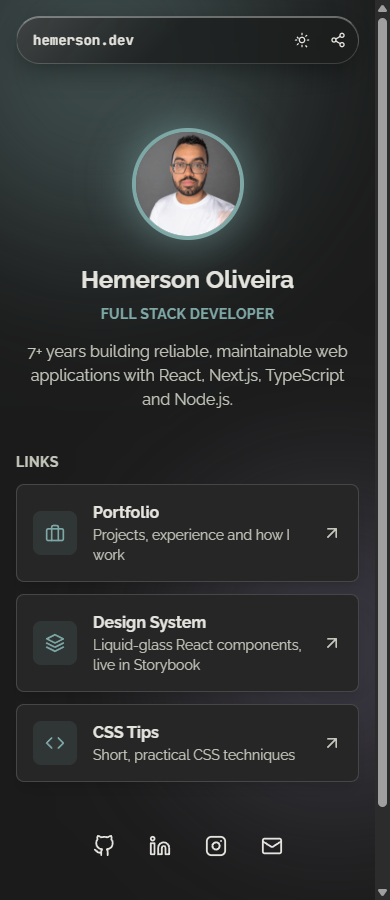
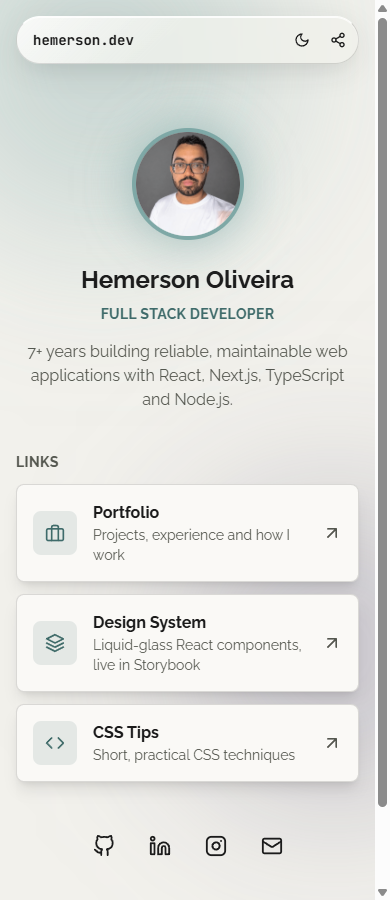
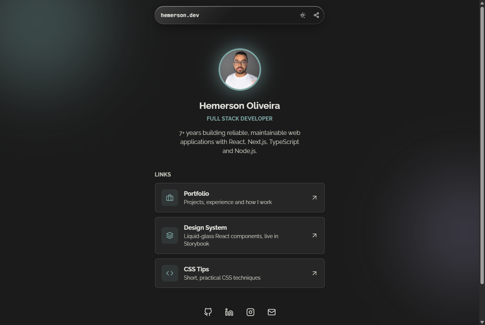

# Social Tree

My links page: portfolio, design system, projects and contact, in one place.

**Live:** https://hemerson-git.github.io/social-tree/

<p>
  
  
</p>



## How it's built

- A static page in [`docs/`](docs), served by GitHub Pages. No build step.
- Styled with [`@hemerson/design-system`](https://www.npmjs.com/package/@hemerson/design-system), loaded from jsDelivr: the tokens, the dark and light themes, and the liquid-glass toolbar, cards, buttons and toast all come from the package. [`docs/assets/styles.css`](docs/assets/styles.css) only lays the page out.
- Follows the system's dark or light setting, with a toggle that remembers your choice.
- **Share** opens the phone's share sheet, or copies the link on desktop.

## Run it locally

Open `docs/index.html` in a browser, or serve the folder:

```bash
npx serve docs
```
